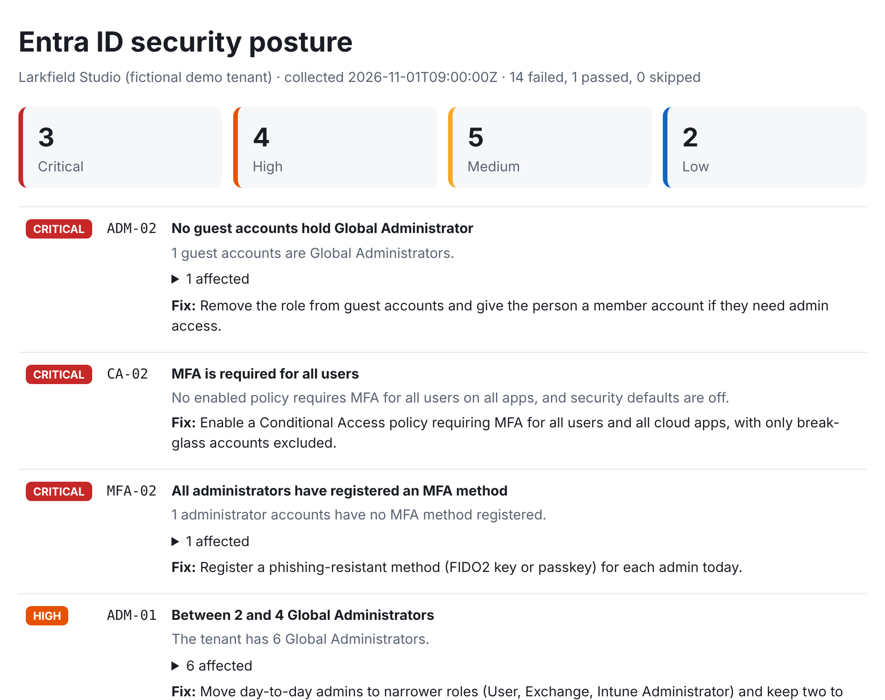

# tenantlint

Read-only security posture checks for Microsoft Entra ID (Azure AD) tenants.

`tenantlint` takes a snapshot of a tenant's identity configuration through Microsoft Graph,
runs 15 checks against it, and tells you what to fix first. It never writes to the tenant.



## Why

Most account takeovers in Microsoft 365 come down to a short list of gaps: no MFA, legacy
sign-in protocols left open, too many Global Administrators, forgotten guest accounts, and
users who can grant any app access to their mailbox. These are quick to fix and tedious to
find by clicking through the portal, especially across several tenants.

## Try it in 30 seconds (no tenant needed)

```
pip install -e .
tenantlint demo --html report.html
```

This runs against a bundled fictional tenant, "Larkfield Studio", which is deliberately
misconfigured. Every name and ID in it is invented.

## Run it against a real tenant

Only run this against a tenant you administer or have written permission to assess.

1. In Entra ID, register an app: **App registrations > New registration**, then under
   **Authentication** enable **Allow public client flows**.
2. Under **API permissions**, add these delegated Microsoft Graph permissions and grant
   admin consent: `Policy.Read.All`, `Directory.Read.All`, `AuditLog.Read.All`,
   `Application.Read.All`. All four are read-only.
3. Collect and check:

```
tenantlint collect --tenant contoso.onmicrosoft.com --client-id <app-id> --out snapshot
tenantlint check snapshot --html report.html
```

`collect` prints a code to enter at microsoft.com/devicelogin. No secret is stored.

## What it checks

| ID | Check | Severity |
|---|---|---|
| CA-01 | Legacy authentication is blocked | High |
| CA-02 | MFA is required for all users | Critical |
| CA-03 | MFA is required for administrators | Critical |
| CA-04 | No policies left in report-only mode | Low |
| CA-05 | Policies have few exclusions | Medium |
| MFA-01 | All users have registered an MFA method | High |
| MFA-02 | All administrators have registered an MFA method | Critical |
| ADM-01 | Between 2 and 4 Global Administrators | High |
| ADM-02 | No guest accounts hold Global Administrator | Critical |
| USR-01 | No stale member accounts (90 days) | Medium |
| GST-01 | No stale guest accounts (90 days) | Medium |
| GST-02 | Guests cannot invite other guests | Medium |
| APP-01 | Users cannot consent to any application | High |
| APP-02 | Users cannot register applications | Low |
| APP-03 | Application secrets are current and short-lived | Medium |

The reasoning behind each check is in [docs/checks.md](docs/checks.md).

## Use it in a pipeline

`--fail-on high` makes the command exit 1 when any high or critical check fails, so a
scheduled job can alert on drift. `--json findings.json` gives machine-readable output.

## How it is built

- `graph.py` collects: GET requests only, paging and throttling handled, saved as JSON.
- `checks.py` decides: each check is a pure function over the snapshot, with no network.
- `report.py` presents: terminal, JSON, and a single-file HTML report with no scripts.

Splitting collection from checking means the checks are unit-tested offline
(`pytest`), and a saved snapshot can be re-checked or compared later.
[docs/walkthrough.md](docs/walkthrough.md) explains the code file by file.

## Limits

- Sign-in activity and MFA registration data need Entra ID P1. Without it those checks
  report "skipped" instead of guessing.
- The Conditional Access checks look for the common policy shapes. An unusual design that
  achieves the same result (for example MFA enforced only through named locations) can
  show as a failure and should be reviewed by hand.
- Collection has been tested against recorded response shapes, not yet against a wide
  range of live tenants. Open an issue if a response breaks it.

## Roadmap

- Compare two snapshots and report what changed
- Risky OAuth grants (apps holding mail or file permissions)
- Privileged Identity Management: standing versus eligible role assignments

## Licence

MIT
